# MagicRemote

Remote desktop client: RDP, SSH, SFTP and FTP/FTPS in one tabbed window. Primarily for Windows, but also runs natively on Linux.

## Screenshots

### Windows

| | |
|---|---|
| 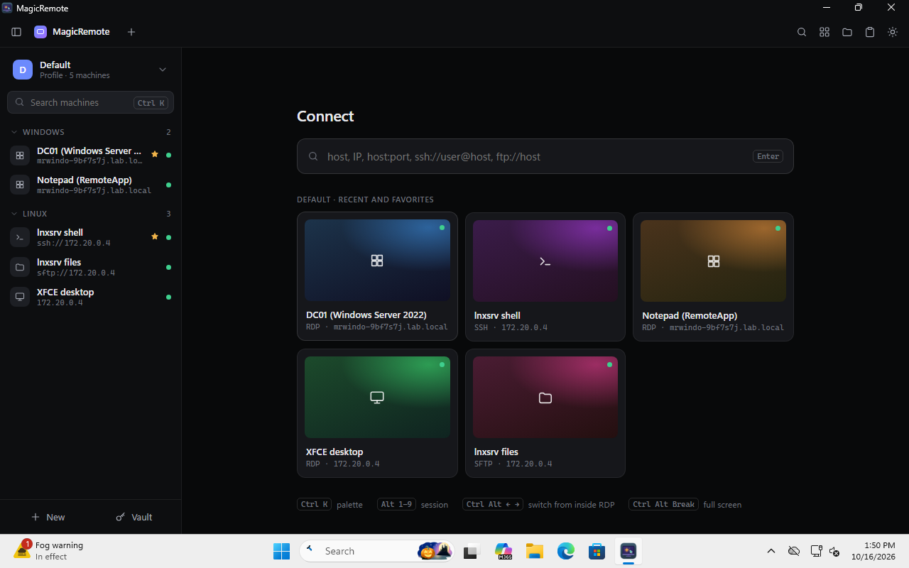 | 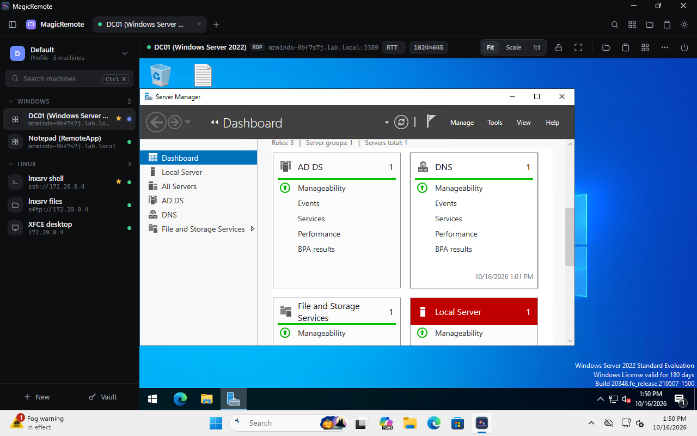 |
| Machines grouped by profile, reachability dots, favorites | RDP to Windows Server 2022 embedded in a tab (mstscax, NLA) |
| 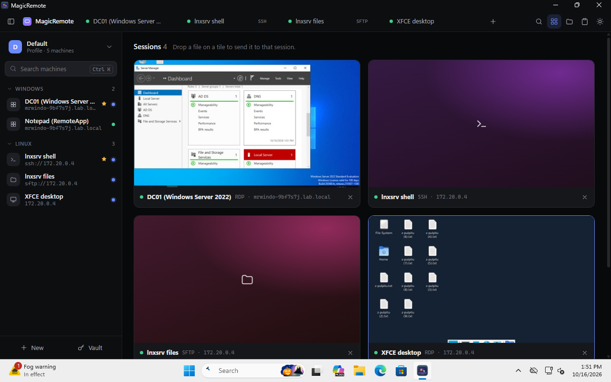 | 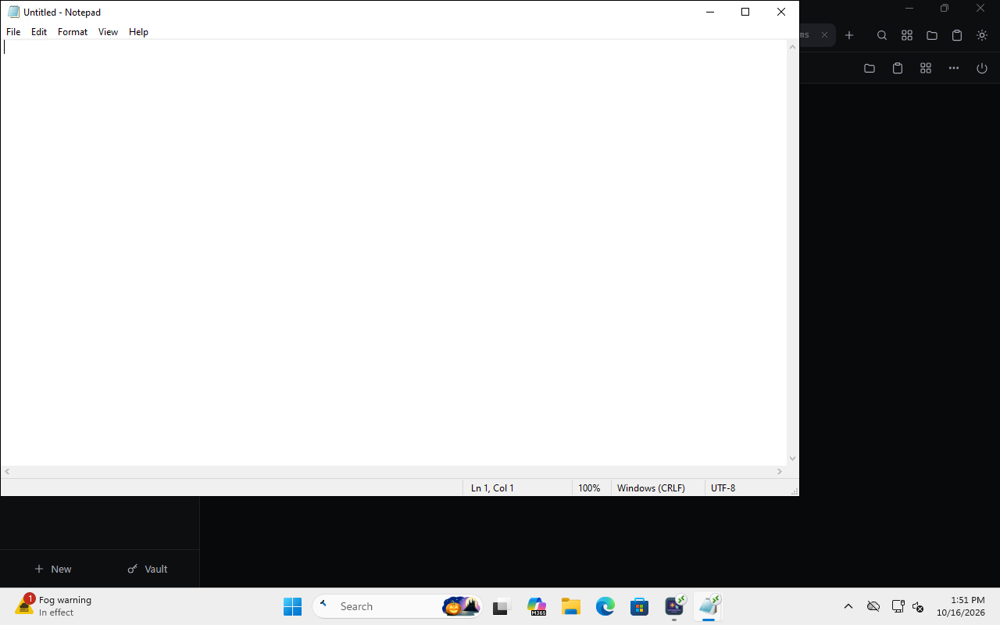 |
| Overview of all open sessions with live thumbnails | RemoteApp: remote Notepad as a local window |
| 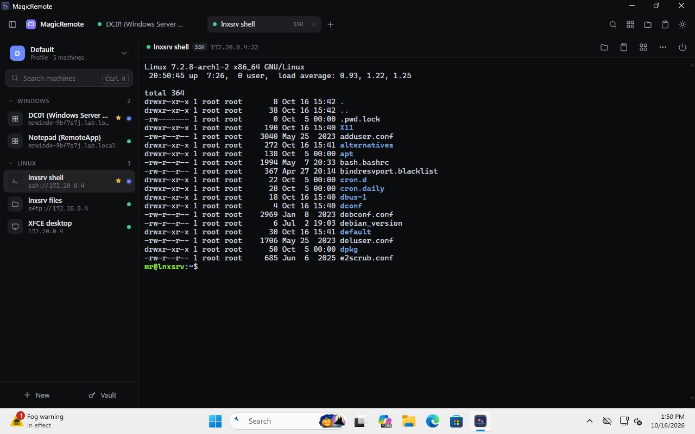 | 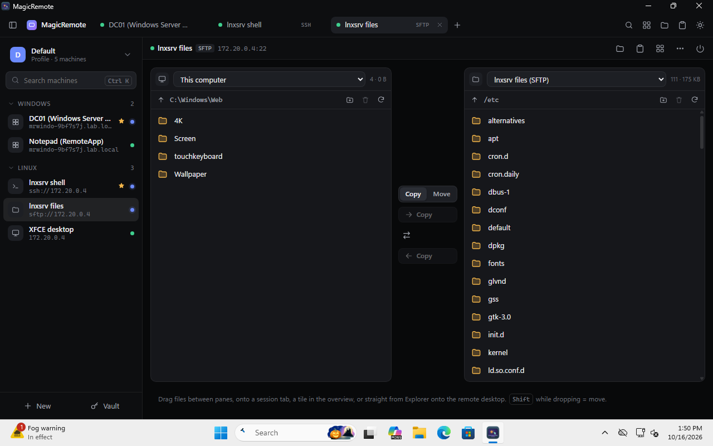 |
| SSH tab (xterm.js) | Two-pane file manager: this computer ↔ SFTP |
| 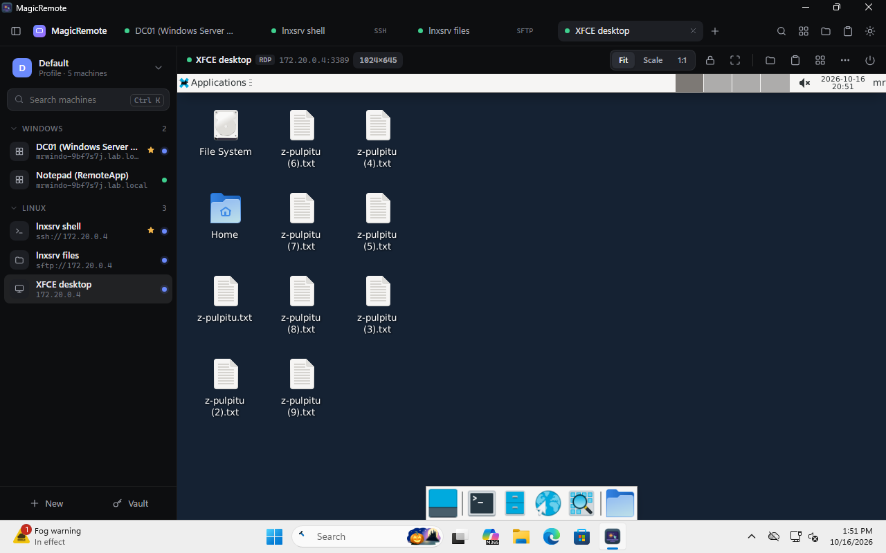 | |
| RDP to a Linux XFCE desktop (xrdp) | |

### Linux

| | |
|---|---|
| 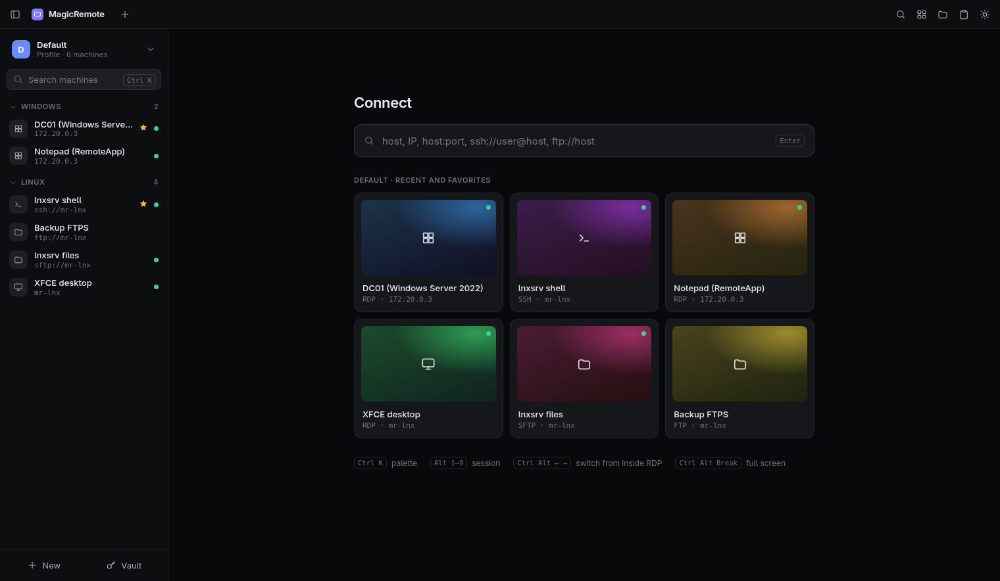 | 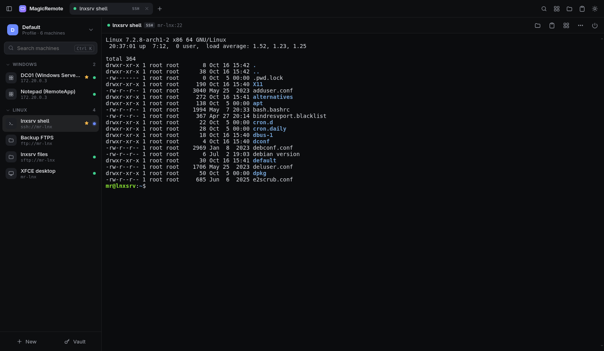 |
| Machines grouped by profile, reachability dots, favorites | SSH tab (xterm.js) |
| 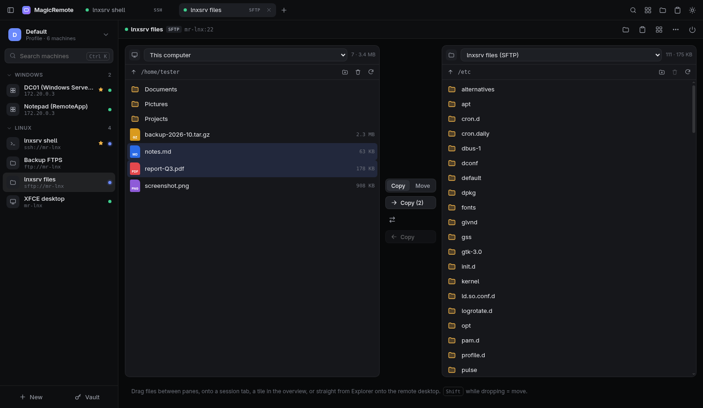 | 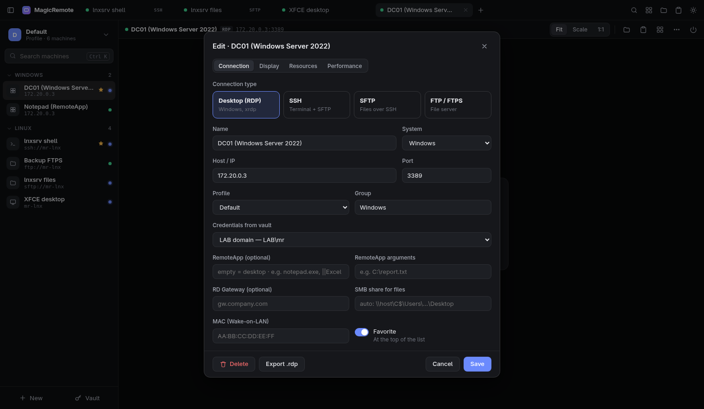 |
| Two-pane file manager: this computer ↔ SFTP | Machine editor with vault credentials |
| 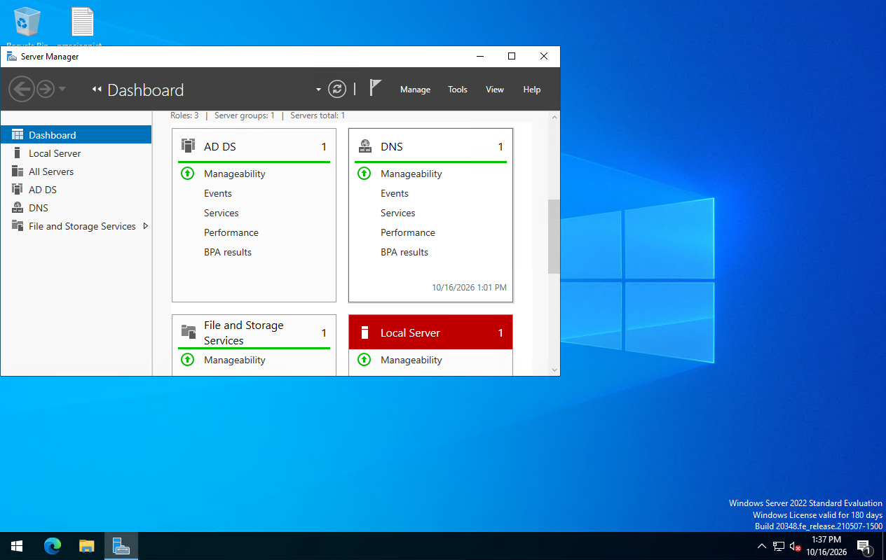 | 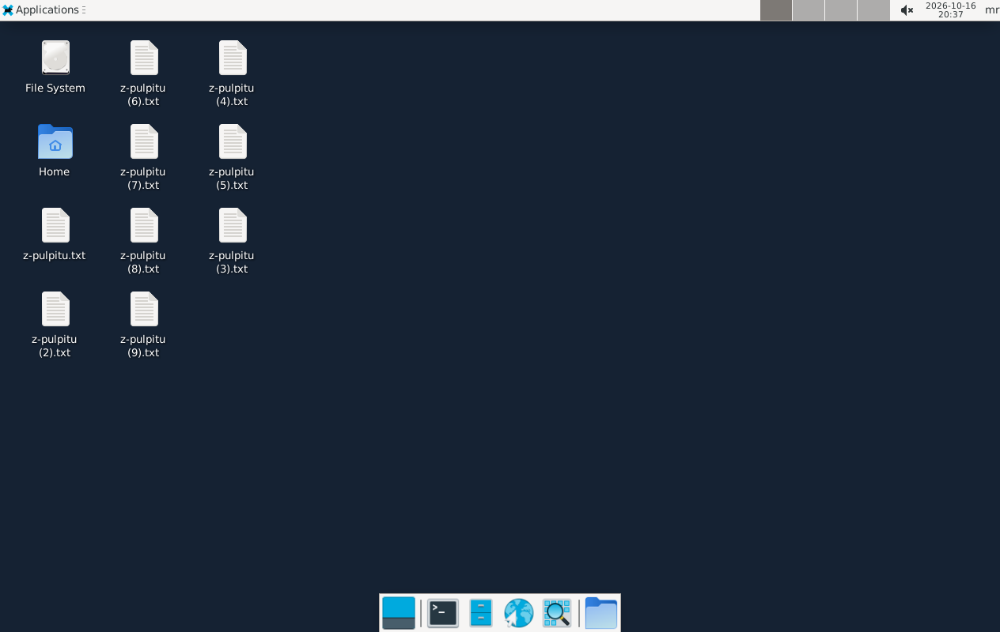 |
| RDP (FreeRDP 3) to Windows Server 2022, NLA | RDP to a Linux XFCE desktop (xrdp) |

## Installation

Ready-made packages are on the [Releases](https://github.com/OppaiHacker/MagicRemote/releases/latest) page: `MagicRemote-<version>-win-x64.zip` and `MagicRemote-<version>-linux-x64.tar.gz` (self-contained, no .NET install needed).

```
MagicRemote.exe --install      # Windows: %LOCALAPPDATA%\Programs\MagicRemote, Start Menu shortcut, entry in "Apps"
./MagicRemote --install        # Linux: ~/.local/share/magicremote/app, ~/.local/bin/magicremote, .desktop entry
MagicRemote --uninstall        # removes the program, data (machines, vault) is kept
```

Updates: on startup the app checks the latest release on GitHub. The package is verified against the SHA-256 checksum from the release, then replaced in place, after which the app restarts.

Requirements:
- **Windows 10/11:** WebView2 Runtime (already included in Windows 11).
- **Linux:** FreeRDP 3 (`xfreerdp3` or `sdl-freerdp3`) for RDP, and a Chromium-based browser (Chromium, Chrome, Edge, Brave) used as the app window. Optional: `secret-tool` (vault key in the keyring), `wl-copy` or `xclip` (clipboard), `gio` with gvfs-smb (SMB shares), `pkexec` (verification before showing a password).

Building from source (.NET 10 SDK; Windows can also be built on Linux):

```
dotnet publish src/MagicRemote -c Release -f net10.0-windows10.0.22621.0 -r win-x64 -o dist-win
dotnet publish src/MagicRemote -c Release -f net10.0 -r linux-x64 -o dist-linux
dist-linux/MagicRemote --selftest
```

## Features

| Area | How |
|---|---|
| Multiple connections at once | Tabs (Alt+1–9) and an overview of all sessions (Ctrl+Shift+O). From inside RDP, switch tabs with Ctrl+Alt+← / → |
| RDP on Windows | `mstscax.dll` engine (the same as mstsc), embedded in a tab: UDP, H.264 AVC444, NLA/CredSSP, RD Gateway, auto-reconnect, multimon, Ctrl+Alt+Del |
| RDP on Linux | FreeRDP 3 in a separate window. Arguments, including the password, are passed via stdin, so they are not visible in the process list. Connection state is read from the FreeRDP log, and exit codes are translated into readable messages |
| RemoteApp | Individual remote programs in separate windows, like local apps (the "RemoteApp program" field in the machine editor) |
| Relative mouse | `RelativeMouseMode` / `/mouse:relative` for games and 3D applications |
| Redirection | Clipboard, drives, audio, microphone, cameras, PnP/MTP devices, COM ports, printers, smart cards |
| Security | Restricted Admin, Remote Credential Guard, certificate verification, password vault |
| Auto-scaling | Fit (host resolution = window size), Scale (1920×1080), 1:1 |
| SSH | xterm.js terminal, password or key, pinned host key (TOFU) |
| Files | Two-pane manager: host ↔ session and session ↔ session, copy or move, progress, cancel. Windows via SMB (`\\host\C$` or a custom share, password login from the vault when the Windows account has no access), Linux via SFTP, FTP/FTPS (certificate pinned on first connection) |
| Drag and drop | From Explorer or a file manager directly onto the RDP image, onto a tab, or onto the file panel. Shift = move |
| Clipboard | Shared history for host and session. Copied passwords are not added to the history |
| `.rdp` files | Import (including by dragging the file, UTF-16 from mstsc) and export |
| Password vault | Windows: DPAPI and Windows Hello before a password is shown (Windows password when Hello is unavailable, e.g. disabled by domain policy). Linux: AES-256-GCM, key in Secret Service or in a 0600 file, polkit before a password is shown |

Data: Windows `%APPDATA%\MagicRemote`, Linux `~/.config/MagicRemote` (or `MAGICREMOTE_DATA`). Passwords are stored there only in encrypted form. Errors go to `error.log` in the same folder.

## Verification

Everything was run headless, on virtual machines and in containers (`tests/`):

- `--selftest`: Windows 18/18, Linux 19/19.
- **Windows 11 in the `lab.local` domain → Windows Server 2022 (DC, NLA) and xrdp**, `tests/e2e-windows.mjs`, result **19/19**:
  - NLA with a password from the vault,
  - wrong password: Windows asks again, Cancel ends with a readable error,
  - Ctrl+Alt+Del opens the security screen in the session,
  - Restricted Admin (event 4624 confirms the mode), Remote Credential Guard (Kerberos),
  - RemoteApp (Notepad in a separate window, without the desktop),
  - SMB `C$` via SSO and a share accessible only to another account (password from the vault),
  - a real mouse drag from Explorer onto the RDP image (copy, and move with Shift),
  - clipboard, COM1 redirection (port visible and openable in the session), relative mouse,
  - RDP to Linux (xrdp), `.rdp` import and export.
- **Windows: installation, update, uninstallation**, `tests/e2e-windows-update.mjs`, result 4/4. A package with a wrong checksum is rejected, and an update to 9.9.9 keeps the data.
- **Linux (Arch, Xvfb, Chromium, FreeRDP 3.32) → xrdp, SSH, SFTP, FTPS and Windows Server**, `tests/lab-linux.sh`, result **20/20 + 4/4**:
  - bridge security (token, Host, path traversal),
  - vault (AES-GCM, 0600 file), FreeRDP in a separate window, password absent from the process list,
  - dropping files, 5 MB transfer there and back with the same checksum,
  - SSH echo ~1–2 ms, SFTP → FTPS, clipboard, polkit,
  - NLA, wrong password, Restricted Admin and RemoteApp on Windows Server,
  - single instance, installation, update and uninstallation.

Running the tests: `tests/lab-linux.sh` (with optional `WIN_DC`, `WIN_USER`, `WIN_PASS`) and `node tests/e2e-windows.mjs` (variables described in the file header).

## Limitations

- Camera: there is no virtual camera in the VM, so redirection is configured (`CameraRedirConfigCollection`) but not tested live.
- PnP/MTP: the client reports the device (tested with a virtual MTP device). Windows Server 2022 without the RDSH role does not accept it, and neither does mstsc. The full path requires a Windows 10/11 host or RDSH.
- "0 ms input lag" over a network does not exist. What remains is RTT and the server's frame time. The cursor is drawn locally.
- On Linux, RDP runs in a separate FreeRDP window, not in a tab. Changing the scaling reconnects the session.

## Structure

```
src/MagicRemote/
  App.cs            shared core: UI messages, sessions, files, transfers, clipboard, vault, updates
  Sessions.cs       SSH/SFTP/FTP sessions, SMB
  FileOps.cs        LocalFs, SftpFs, FtpFs, copy engine
  Store.cs          profiles, machines, credentials (DPAPI / AES-GCM)
  RdpFile.cs        .rdp import/export
  Updater.cs        updates from GitHub Releases
  Installer.cs      --install / --uninstall
  Win/              WinForms + WebView2 window, RDP via mstscax
  Linux/            local server + browser window, RDP via FreeRDP, vault key
  wwwroot/          UI (HTML/CSS/JS, xterm.js)
tests/              selftest, E2E via CDP (Windows, Linux, updates)
```

## License

[GNU GPL v3](LICENSE). MagicRemote is free software and stays free: every copy and every fork must be distributed under the same license, with its source code.
